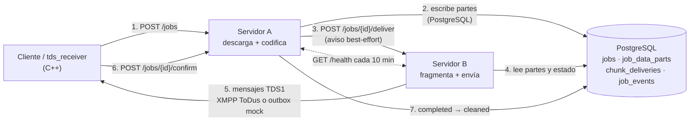

# Arquitectura

## Vista general



Los dos servicios son ejecutables nativos C++20 distintos
(`tds_server_a`, `tds_server_b`) construidos desde el mismo repositorio y la
misma imagen Docker. Comparten PostgreSQL, que es la única fuente de verdad
del estado de los trabajos. Ninguno usa el disco local para transportar datos
entre A y B.

## Componentes

### `shared/` — biblioteca de protocolo

| Módulo | Responsabilidad |
|---|---|
| `encoding` | Tabla fija v1 de 256 símbolos: bytes ⇄ texto UTF-8, sin hexadecimal ni binario intermedio. |
| `framing` | Formato de trama `TDS1`, presupuesto de payload y plan de tramas. |
| `reassembler` | Recibe tramas fuera de orden, detecta duplicados/huecos y verifica tamaño + SHA-256. |
| `sha256`, `crc32` | Hashes (OpenSSL y CRC-32 propio). |
| `http` | Cliente HTTP con libcurl: timeouts, límite de tamaño, descarga en streaming con hash al vuelo. |
| `xmpp` | Cliente XMPP/TLS propio (OpenSSL): TLS directo, SASL PLAIN, bind, envío y acuses `tdack`. |
| `protobuf_auth` | Codificación/decodificación manual del mensaje `v2/auth/token` de ToDus. |
| `transport` | Interfaz `Transport`, `MockTransport` para pruebas sin cuenta. |
| `config`, `log`, `util`, `pinger`, `job` | Configuración por entorno, logs, utilidades, ping mutuo y estados. |

### `storage/` — persistencia

`JobStore` (interfaz) + `PgStore` (implementación PostgreSQL con pool de
conexiones y `FOR UPDATE SKIP LOCKED` para reservas atómicas). Incluye el hilo
de mantenimiento (`maintenance.cpp`) que expira trabajos atascados y purga
metadatos antiguos.

### `server_a/` — descarga y codificación

- `POST /jobs` valida URL y destinatario, crea el trabajo y devuelve
  `job_id` + `client_token`.
- El *worker* reclama trabajos `queued`, descarga con límites y protección
  SSRF, calcula SHA-256, codifica por bloques y guarda las partes en la base
  de datos, dejando el trabajo en `ready_for_delivery`.
- Avisa a B (`POST /jobs/{id}/deliver`) sin bloquear la petición HTTP; si el
  aviso falla, B lo recoge por sondeo.

### `server_b/` — fragmentación y envío

- Reclama `ready_for_delivery` (y `sending` tras un reinicio) de forma atómica.
- Calcula el plan de tramas con `MAX_STANZA_BYTES` y lo persiste
  (`total_chunks`) para que el cliente sepa cuántas esperar.
- Envía trama a trama con reintentos limitados, registrando cada índice en
  `chunk_deliveries`; al reanudar omite las ya enviadas.
- Transportes: `mock` (ficheros, para integración local) y `todus` (XMPP real).
- Pasa a `awaiting_client_confirmation`; **no** marca `completed` por haber
  enviado: eso sólo ocurre cuando el cliente confirma el SHA-256.

### `client/` — receptor (`tds_receiver`)

Componente receptor acordado (CLI C++). Modos:

- `--frames DIR`: lee tramas de un directorio (salida del transporte mock).
- `--xmpp-user … --xmpp-token …`: escucha tramas por ToDus.

En ambos casos reensambla, verifica tamaño y SHA-256, escribe el fichero de
forma atómica y opcionalmente confirma al Servidor A (`--confirm`).

## Estados

```text
created → queued → downloading → encoding → ready_for_delivery
        → sending → awaiting_client_confirmation → completed → cleaned
```

Errores: `failed_download`, `failed_encoding`, `failed_delivery`,
`failed_reconstruction`, `cancelled`, `expired`.

`completed` sólo se alcanza con `sha256` y `size` idénticos a los del fichero
descargado. La limpieza de payloads ocurre después (`cleaned`). Un trabajo
abandonado se marca `expired` según `STALE_JOB_MINUTES` (en curso) o
`CLIENT_CONFIRM_HOURS` (listo/esperando confirmación).

## Modelo de datos

| Tabla | Contenido |
|---|---|
| `jobs` | Metadatos, estado, hashes, plan de tramas, lease y fechas. |
| `job_data_parts` | Payload codificado por bloques (`ENCODE_PART_BYTES`). Se borra al confirmar. |
| `chunk_deliveries` | Índice, intentos, error y acuse de cada trama. |
| `job_events` | Traza de auditoría por trabajo. |
| `schema_migrations` | Versiones aplicadas. |

Migraciones versionadas en `database/migrations/`; se aplican al arrancar de
forma idempotente.

## Formato de trama

```text
TDS1|<job_id>|<transfer_id>|<chunk_index>|<total_chunks>|<enc_ver>|<crc32>|<payload>
```

- Identificadores restringidos a `[A-Za-z0-9_-]`, máximo 64 caracteres.
- `payload` usa la tabla v1, que **no contiene** `|`, así que no hacen falta
  escapes.
- `crc32` es el CRC-32 del payload en hexadecimal; el receptor rechaza la
  trama antes de decodificar si no coincide.
- El tamaño del mensaje se mide en **bytes UTF-8**, no en caracteres. El
  presupuesto reserva cabecera conservadora y comprueba el tamaño exacto al
  serializar.

## Codificación

Cada byte se transforma directamente en un símbolo de la tabla v1
(`shared/resources/table_v1.txt`). La tabla tiene 256 símbolos únicos,
estables ante NFC/NFKC y sin caracteres especiales de XML ni `|`.
Ver [tabla-codificacion.md](tabla-codificacion.md).

## API interna

### Servidor A

| Método | Ruta | Autorización | Descripción |
|---|---|---|---|
| `GET` | `/health` | pública | Estado del servicio y de la base de datos. |
| `GET` | `/ready` | pública | Indica si puede aceptar trabajos (base disponible). |
| `POST` | `/jobs` | `X-Internal-Token` | Crea un trabajo. Devuelve `job_id`, `transfer_id`, `client_token`. |
| `GET` | `/jobs/{id}` | `X-Client-Token` o interno | Estado, metadatos y progreso (`delivered_chunks`). |
| `POST` | `/jobs/{id}/confirm` | `X-Client-Token` o interno | Confirma hash/tamaño; limpia payloads. Idempotente. |
| `GET` | `/jobs/{id}/events` | interno | Traza del trabajo. |
| `GET` | `/stats` | interno | Contadores del proceso. |

### Servidor B

| Método | Ruta | Autorización | Descripción |
|---|---|---|---|
| `GET` | `/health` | pública | Estado + transporte activo. |
| `GET` | `/ready` | pública | Base disponible. |
| `POST` | `/jobs/{id}/deliver` | `X-Internal-Token` | Despierta al worker; reintenta `failed_delivery`. |
| `GET` | `/jobs/{id}` | interno | Estado de entrega. |
| `GET` | `/stats` | interno | Tramas y bytes enviados. |

Las operaciones internas usan comparación en tiempo constante del token.

## Decisiones y alternativas descartadas

| Decisión | Motivo | Alternativa descartada |
|---|---|---|
| Drogon como único framework HTTP | Ya disponible en Ubuntu/Docker, integra JSON y bucles de eventos; evita mantener dos frameworks. | Boost.Beast (más código propio) o un segundo framework para B. |
| PostgreSQL compartido, no disco local | A y B son procesos/servicios distintos; la base es la única fuente de verdad y soporta leases con `SKIP LOCKED`. | Ficheros en `/tmp` (efímeros) o almacenamiento de objetos sin garantía en el plan gratuito. |
| Bloques de 64 KiB en `job_data_parts` | Evita campos gigantes y permite borrar todo al confirmar; el coste es ~1,66 veces el vídeo. | Guardar el texto codificado entero en una sola fila o en disco. |
| Tabla v1 de 256 símbolos UTF-8 | Reversible, sin el separador de campos ni especiales XML, estable ante NFC/NFKC. | Base64/hexadecimal (más tamaño y no cumple “sin cadenas hexadecimales”). |
| Un worker por servicio (`MAX_CONCURRENT_JOBS=1`) | Render gratuito da 0,1 CPU y 512 MB; la concurrencia se limita en la base. | Varios workers en el mismo proceso, sin medición de recursos. |
| CLI `tds_receiver` como componente receptor | Acordado con el cliente; reutiliza la misma biblioteca C++ y permite verificar el protocolo sin una app móvil. | Cliente Android nuevo (fuera del alcance y sin cuenta ToDus autorizada). |

## Seguridad

- **SSRF**: sólo `https` por defecto; se resuelve el host una vez, se rechazan
  direcciones privadas/reservadas y se fija la IP validada con
  `CURLOPT_RESOLVE` para evitar *DNS rebinding*. Redirecciones revalidadas.
- **Límites**: `MAX_VIDEO_BYTES`, timeouts de conexión/global, baja velocidad y
  máximo de redirecciones.
- **Autorización**: token interno para operaciones entre servicios; token de
  cliente (hash SHA-256 en la base) para leer/confirmar un trabajo.
- **Secretos**: sólo variables de entorno; `.env.example` sin credenciales.
- **Logs**: sin contenido de vídeo, tokens ni números de teléfono completos.
- **Limpieza**: payloads borrados sólo tras confirmación o expiración segura.

## Tolerancia a fallos

- Reclamo con lease renovable: si un worker muere, el trabajo se recupera.
- `chunk_deliveries` evita reenviar tramas ya aceptadas.
- El receptor tolera duplicados, desorden y detecta huecos y CRC.
- La limpieza y la expiración son tareas SQL idempotentes.
- El ping mutuo cada 10 min es un intento de mitigar la suspensión de Render,
  **no una garantía** (ver [limitaciones.md](limitaciones.md)).
